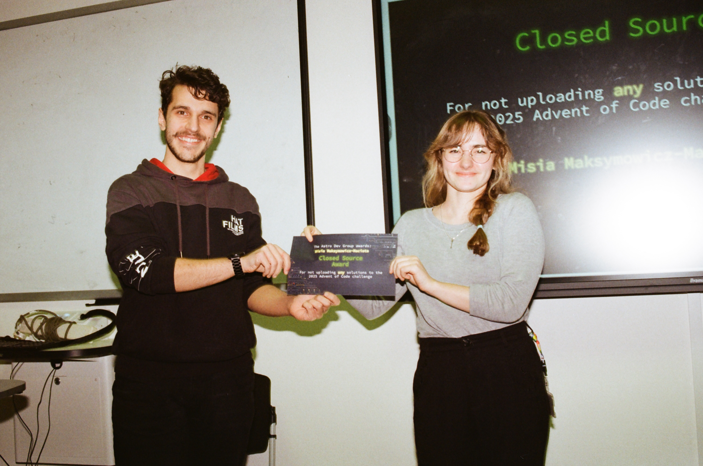
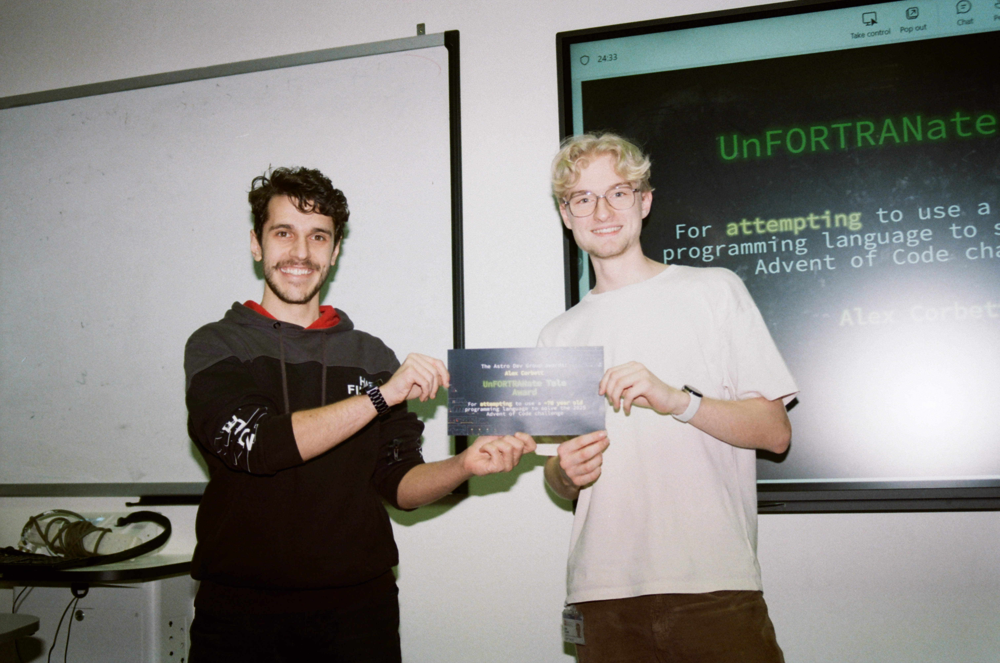
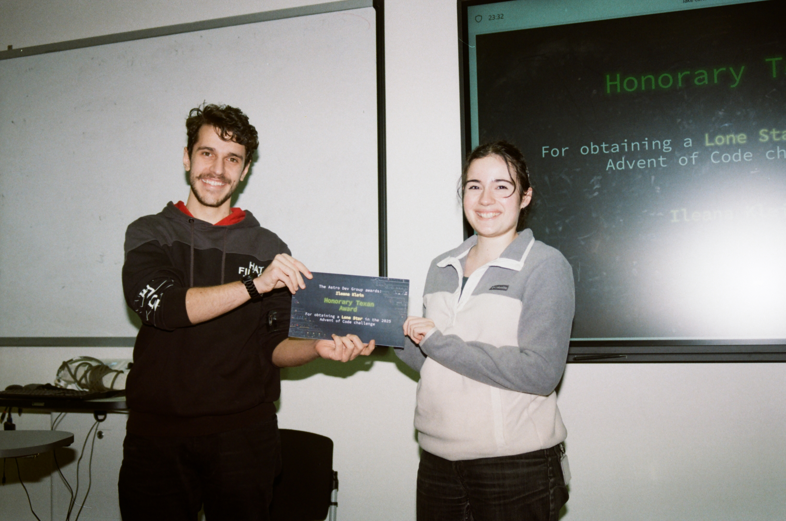
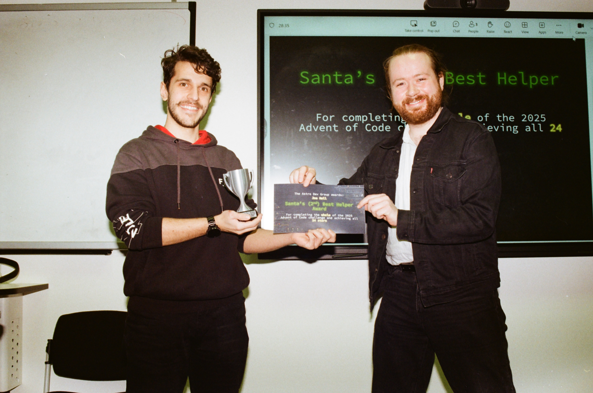
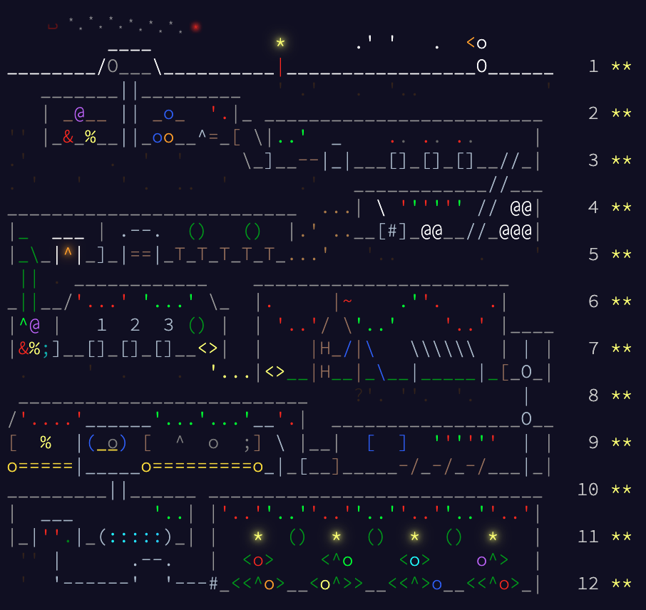
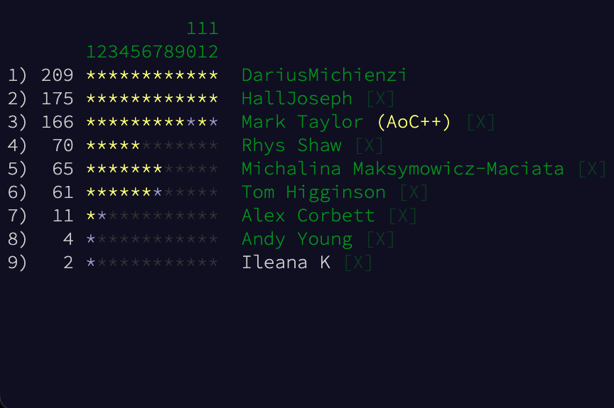

## {.title-dark}

::: {.tw}
::: {.kicker}
Astrophysics Developer Group · 27 Nov 2026
:::

::: {.titlestack}
::: {.titletext .fragment .fade-out fragment-index="1"}
Advent of Code 2026
:::

::: {.titletext .fragment .fade-in-then-out fragment-index="1"}
Wins
:::

::: {.titletext .fragment .fade-in-then-out fragment-index="2"}
Issues
:::

::: {.titletext .fragment .fade-in-then-out fragment-index="3"}
News
:::

::: {.titletext .remind .fragment fragment-index="4"}
Backup reminder
:::
:::

::: {.authors}
The yearly Christmassy coding challenge
:::

::: {.meta}
Darius Michienzi
:::
:::

{.specline fig-alt="Twelve days, each with two gold stars"}

::: {.notes}
Click 1, Wins: 

Click 2, Issues: 

Click 3, News: 

Click 4: Backup reminder.
:::

## What is Advent of Code {eyebrow="Day 1"}

- Yearly programming [puzzles]{.hl} in the style of an advent calendar, with a new one released every day
- Started in 2015 by Eric Wastl: this is the [12th]{.hl} year
- Designed to be accessible at any [level]{.hl}, on any [hardware]{.hl}, in any [programming language]{.hl}: every puzzle has a solution that runs in [15 seconds]{.hl} or less on ten-year-old hardware
- It is meant to be [challenging]{.hl}, but there are many different approaches to solve everything

::: {.closer}
[adventofcode.com/2026](https://adventofcode.com/2026) · first puzzle [Tue 1 Dec, 05:00]{.gold} UK time
:::

::: {.notes}
Puzzles unlock at midnight EST (UTC-5), which is 05:00 in the UK in December.
:::

## Why you should do it {eyebrow="Day 2"}

- Great way to [practise]{.hl} coding skills
- Learn or practise a [new language]{.hl}
- Only [12 days]{.hl}, so it is all done well before Christmas
- It's [fun]{.hl}
- For those who compete in it there may be [prizes]{.hl}

::: {.photos .grid4 .fragment .custom style="margin-top:34px"}
{fig-alt="Prize ceremony photo 1"}

{fig-alt="Prize ceremony photo 2"}

{fig-alt="Prize ceremony photo 3"}

{fig-alt="Prize ceremony photo 4"}
:::

::: {.notes}
Photos from last year's debrief and prize ceremony (January 2026).
:::

## How does it work {eyebrow="Day 3"}

:::: {.columns}
::: {.column width="60%"}
- [Two puzzles]{.hl} to solve each day: part two unlocks when you solve part one, with increasing [difficulty]{.hl}
- Each day has some [input]{.hl} unique to each person
- Collect one [star]{.hl} for each solution, for a total of [24 stars]{.hl} (12 days × 2)
- Stuck? Check your code against the worked [examples]{.hl} in the puzzle text first
:::

::: {.column width="37%"}
::: {.fill style="height:500px"}
{fig-alt="Advent of Code calendar"}
:::
:::
::::

## What's new since 2025 {eyebrow="Day 4"}

:::: {.grid4}
::: {.stat}
[Days]{.k}

[12]{.v}

[down from 25 since 2025; still starts 1 Dec]{.d}
:::

::: {.stat}
[Stars]{.k}

[24]{.v}

[two per day, as before]{.d}
:::

::: {.stat}
[Unlock]{.k}

[05:00]{.v}

[UK time; midnight EST (UTC−5)]{.d}
:::

::: {.stat}
[Global board]{.k}

[None]{.v}

[removed in 2025; private boards only]{.d}
:::
::::

:::: {.grid2 .med style="margin-top:28px"}
::: {.paper}
[AI]{.lab}
The official FAQ asks people **not** to use AI to solve the puzzles: "it's like sending a friend to the gym for you."
:::

::: {.take}
[Private leaderboards]{.lab}
Each private board sets its own rules (AI, languages, upload etc.). Ours are on the leaderboard slide.
:::
::::

::: {.notes}
The FAQ on adventofcode.com/2026/about explains both changes: fewer days because building the puzzles takes so much of Eric's free time, and the global leaderboard was removed because of the stress it caused. Private leaderboards can now be shared as a read-only view.
:::

## Some examples from previous years {.demo eyebrow="Live demo"}

:::: {.grid5 .thumbs}
](figs/example-2021.png){width="100%"}

](figs/example-2022.png){width="100%"}

](figs/example-2023.png){width="100%"}

](figs/example-2024.png){width="100%"}

](figs/calendar.png){width="100%"}
::::

[These are some good starter puzzles to try. Click a year to open its calendar.]{.xs}

::: {.notes}

:::

## Leaderboards {eyebrow="Day 5"}

:::: {.columns}
::: {.column width="52%"}
::: {.fill style="height:400px"}
{fig-alt="Last year's private leaderboard"}
:::
:::

::: {.column width="45%"}
- There will be a [leaderboard]{.hl} people can join for friendly competition. check the Advent of Code channel on slack
- Use the channel to discuss with others or ask for hints. 
- Use any language you like. Maybe set yourself a personal challenge 
- Complete as much as you can and make your code available on [[GitHub]{.hl}](https://github.com/DariusMichienzi/Advent-of-code)
- It will be reviewed in January in the debrief and [Prize Ceremony]{.hl}
:::
::::

::: {.closer .fragment .custom}
[Give it a go and have fun!]{.gold}
:::

::: {.notes}
Join at adventofcode.com/2026/leaderboard/private.
:::

## Any Other Business? {.bigcentre}

## PUB? {.bigcentre}

::: {.subline}
[[Pubinator]{.hl}](https://dariusmichienzi.github.io/Pubinator9000/)
:::
